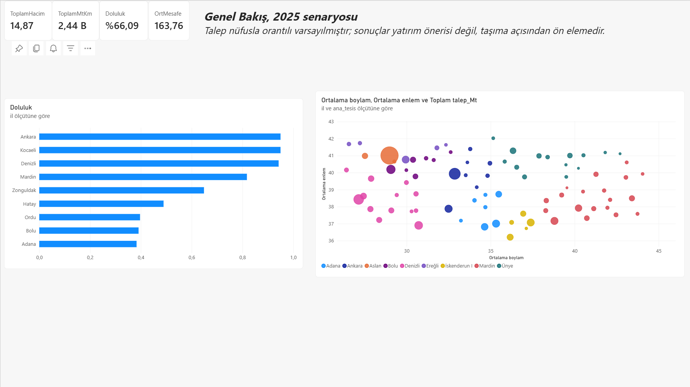
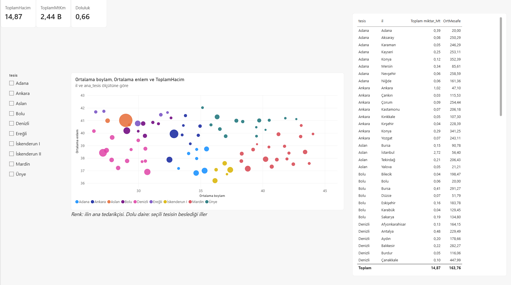
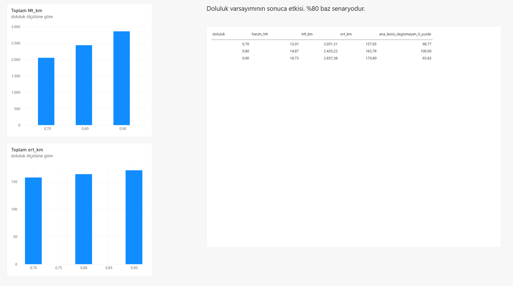
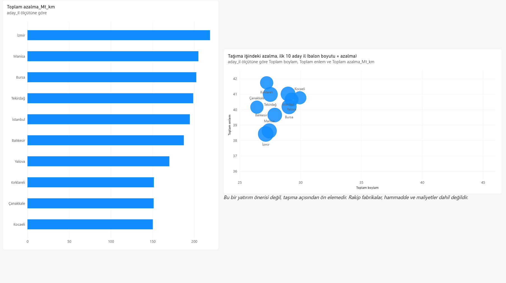
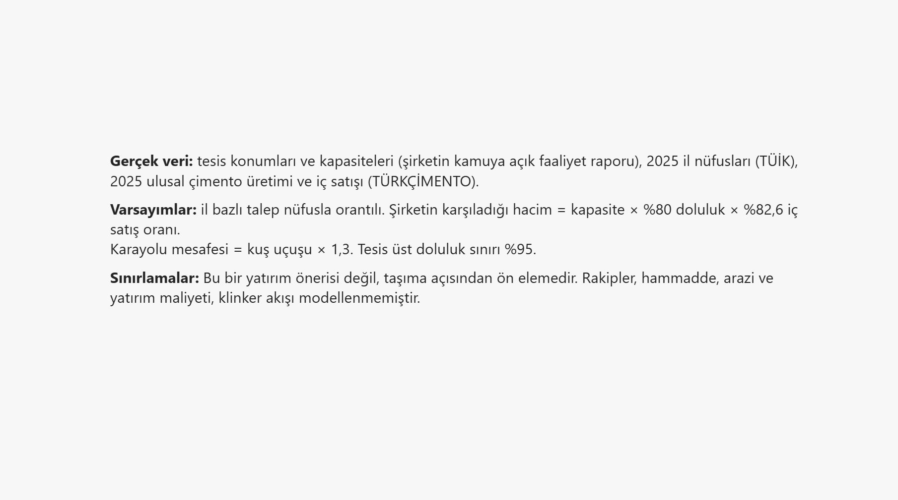

# Çimento Dağıtım Ağı Optimizasyonu: Kapasite Kısıtlı Taşıma Modeli

[English version](README_en.md)

Türkiye'de faaliyet gösteren bir çimento üreticisinin 10 tesislik ağı için, il bazlı talebi en düşük taşıma işiyle karşılayan bir doğrusal programlama modeli (Python, PuLP). Model ayrıca "yeni bir tesis nereye açılırsa taşıma işi en çok azalır?" sorusunu ön eleme olarak yanıtlar.

> Bu proje kamuya açık verilerle hazırlanmış **senaryo bazlı bir vaka çalışmasıdır**. Şirketin iç verisi (gerçek sevkiyat, maliyet, müşteri) kullanılmamıştır. Neyin gerçek veri, neyin varsayım olduğu aşağıda ayrıca belirtilmiştir.

## Problem

Şirketin 7 entegre (klinker + çimento) ve 3 öğütme tesisi var. 2025 talebi 81 ile dağıtıldığında, her tesis hangi illeri beslemeli ve toplam taşıma işi (ton-km) ne olur? Mevcut ağın taşıma açısından en büyük boşluğu hangi bölgede?

## Veri kaynakları ve neyin gerçek, neyin varsayım olduğu

| Girdi | Kaynak | Durum |
|---|---|---|
| Tesis konumları ve çimento/klinker kapasiteleri | Şirketin kamuya açık faaliyet raporu (2025), KAP | Gerçek |
| İl nüfusları (2025, toplam 86.092.168) | TÜİK, Adrese Dayalı Nüfus Kayıt Sistemi | Gerçek |
| Ulusal çimento üretimi (77,19 Mt) ve iç satışı (63,77 Mt), 2025 | TÜRKÇİMENTO, Aylık Ekonomik Rapor (Aralık 2025) | Gerçek |
| İl ve tesis koordinatları | Şehir/ilçe merkezi, yaklaşık değerler | Yaklaşık |
| İl bazlı talep | Nüfusla orantılı dağıtım | **Varsayım** |
| Şirketin karşıladığı hacim | Kapasite × doluluk (%80) × iç satış oranı (%82,6) | **Varsayım** |
| Karayolu mesafesi | Kuş uçuşu × 1,3, alt sınır 20 km | **Varsayım** |

## Yöntem

**Talep.** Şirketin iç satış hacmi, `toplam kapasite × doluluk × (ulusal iç satış / ulusal üretim)` formülüyle bulunur (baz senaryoda 22,5 × 0,80 × 0,826 = 14,87 Mt/yıl) ve illere nüfus payına göre dağıtılır.

**Model.** `x[i,j]`, tesis i'den il j'ye taşınan miktar (Mt/yıl):

```
min  Σ x[i,j] · d[i,j]                  (toplam Mt·km)
s.t. Σ_i x[i,j] = talep[j]              her ilin talebi karşılanır
     Σ_j x[i,j] ≤ 0,95 · kapasite[i]    tesis üst doluluk sınırı
     x[i,j] ≥ 0
```

**Yeni tesis analizi.** Her ile varsayımsal 1 Mt kapasiteli bir tesis eklenip model yeniden çözülür, taşıma işindeki azalma sıralanır.

## Sonuçlar (baz senaryo)

- Şirketin karşıladığı iç satış: **14,87 Mt/yıl** (kapasitenin %66'sı)
- Toplam taşıma işi: **2.435 milyon ton-km**, ağırlıklı ortalama mesafe **164 km**
- Doluluk (il bazında): Ankara %95, Kocaeli %95, Denizli %94, Mardin %82, Zonguldak %65, Hatay %49, Ordu %40, Bolu %39, Adana %38

**Duyarlılık (doluluk varsayımı):**

| Doluluk | Hacim (Mt) | Mt·km | Ort. mesafe (km) | Ana tedarikçisi değişmeyen il |
|---|---|---|---|---|
| %70 | 13,01 | 2.051 | 158 | %98,8 |
| %80 (baz) | 14,87 | 2.435 | 164 | %100 |
| %90 | 16,73 | 2.857 | 171 | %93,8 |

İllerin ana tedarikçisi doluluk varsayımına büyük ölçüde duyarsız.

**Yeni tesis adayları** (1 Mt, taşıma işindeki azalma):

| Sıra | Aday il | Azalma (Mt·km) | Azalma (%) |
|---|---|---|---|
| 1 | İzmir | 219 | 9,0 |
| 2 | Manisa | 205 | 8,4 |
| 3 | Bursa | 202 | 8,3 |
| 4 | Tekirdağ | 199 | 8,2 |
| 5 | İstanbul | 195 | 8,0 |

Model Marmara ve Ege'de, nüfusun yoğun olduğu ama tesislerin seyrek kaldığı bir taşıma boşluğu gösteriyor.

## Pano (Power BI)

Sonuçlar beş sayfalık bir Power BI panosunda sunuldu. Veriler `powerbi/` klasöründeki CSV'lerden yüklenir. Pano herkese açık yayımlanmamıştır, aşağıda ekran görüntüleri yer alır.

| Genel Bakış | Tedarik Ağı |
|---|---|
|  |  |

| Duyarlılık | Yeni Tesis |
|---|---|
|  |  |



## Sınırlamalar

- **Bu bir yatırım önerisi değil, taşıma açısından ön elemedir.** Rakip fabrikalar, hammadde (kireçtaşı) konumu, arazi ve yatırım maliyeti modelde yok.
- Talep nüfusla orantılı ve şirketin payı her ilde aynı varsayıldı; gerçekte çimento talebi inşaat faaliyetine bağlıdır ve pazar payı bölgeye göre değişir. Yapı ruhsatı verisiyle analiz tekrarlanabilir.
- Maliyeti küçülten çözüm bazı tesisleri %95 sınırına, bazılarını çok düşük dolulukta bırakıyor. Üretim maliyeti ve klinker akışı modellenmedi.
- Öğütme tesisleri (İskenderun, Ereğli) klinkeri dışarıdan alır; burada çimento üreten tesis gibi ele alındı.
- İskenderun I ve II aynı koordinatta; çözücü aralarındaki dağılımı keyfi yapar, sonuçlar il bazında okunmalı.
- Mesafeler yaklaşık karayolu tahminidir, ihracat ve yurt dışı tesisler kapsam dışıdır.

## Nasıl çalıştırılır

```bash
pip install "pulp<4" pandas matplotlib jupyter
jupyter notebook dagitim_modeli.ipynb
```

PuLP 4.x'in arayüzü farklı olduğu için `pulp<4` kurulmalıdır. Notebook, CSV dosyalarını aynı klasörde arar (`VERI = "."`); dosyaları bir alt klasöre taşırsan bu değişkeni güncelle.

## Dosyalar

| Dosya | İçerik |
|---|---|
| `dagitim_modeli.ipynb` | Model, sonuçlar, duyarlılık ve yeni tesis analizi |
| `tesisler.csv` | 10 tesis: il, ilçe, koordinat, kapasite |
| `iller_nufus_2025.csv` | 81 il, 2025 nüfusu ve payı |
| `il_koordinatlari.csv` | 81 il koordinatları |
| `mesafe_tesis_il_km.csv`, `mesafe_il_il_km.csv` | Tahmini karayolu mesafe matrisleri |
| `mesafe_hesapla.py` | Mesafe matrislerini üreten kod |
| `powerbi/` | Power BI panosunun veri dosyaları (5 CSV) |
| `images/` | Pano ekran görüntüleri |
| `README_en.md` | İngilizce sürüm |

## Olası geliştirmeler

- Yapı ruhsatı verisiyle ikinci bir talep senaryosu
- Gerçek karayolu mesafeleri ve TL/ton-km nakliye maliyeti
- Klinker akışı (entegre tesislerden öğütme tesislerine) ve iki aşamalı ağ
